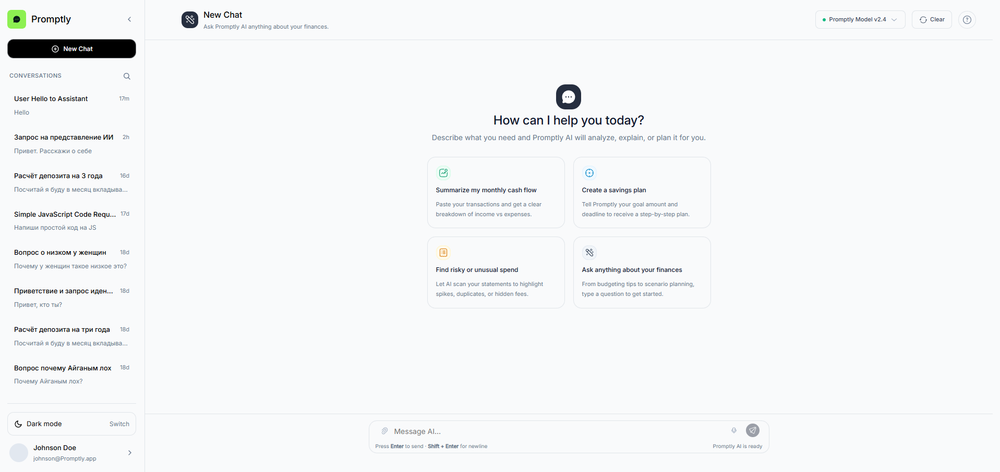
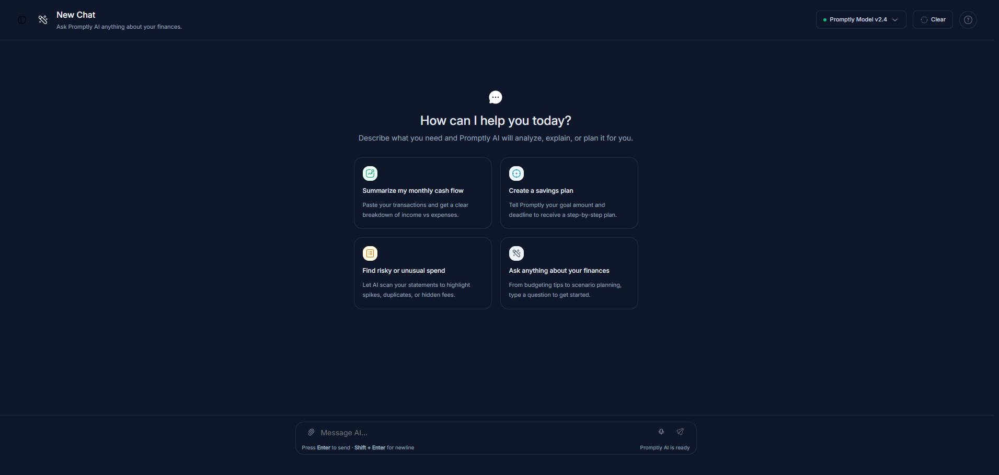
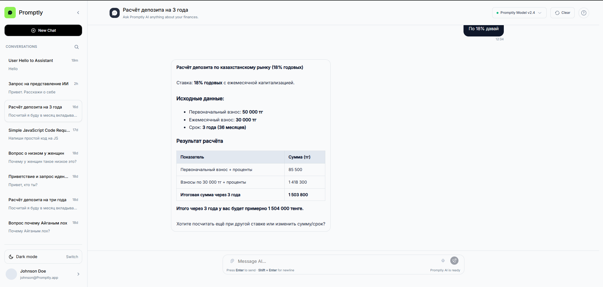

<div align="center">

# Promptly

**A clean, ChatGPT-style web interface for an AI assistant — built with React and plain JavaScript.**


[Live demo (soon)](#) · [Report a bug](https://www.linkedin.com/in/alikhan-murat-baurzhanuly/) · [Roadmap](#roadmap)

<!-- Add a screenshot or GIF here: -->



<!--  -->

</div>

---

## About

Promptly is a pet project: a chat UI for an AI assistant focused on personal finance questions ("Ask Promptly AI anything about your finances"). It started as a hand-written HTML/CSS layout and was then migrated to React with a deliberate constraint: **no state-management libraries and no UI kits** — only native React hooks.

The goal is to practice component architecture, state lifting and data flow, and then grow the app step by step into a full-stack product with a real LLM backend.

## Features

- Multiple chats with persistent history (saved to `localStorage`)
- Welcome screen with suggested prompts
- Message list with user / assistant roles and timestamps
- Auto-growing message input
- Model selector and "Clear chat" controls in the header
- Real AI responses powered by the Grok API (xAI)

## Tech stack

| Area        | Choice                                               |
| ----------- | ---------------------------------------------------- |
| UI          | React, JSX                                           |
| Language    | JavaScript (no TypeScript, for now)                  |
| Build tool  | Vite                                                 |
| State       | `useState`, `useEffect`, `useRef`, `useMemo`, `useCallback` |
| AI          | Grok API (xAI)                                       |
| Persistence | `localStorage`                                       |
| Styling     | Plain CSS, split into base and per-component files   |

## Architecture notes

- **State lives in a custom hook.** `useChats` owns the list of chats, the active chat id and the `sendMessage` logic, and exposes them to the component tree via props (state lifting).
- **Lazy initialisation** of state reads `localStorage` only once on the first render.
- **Persistence via `useEffect`:** every change to `chats` is written back to storage.
- **Data model:**

```js
// Chat
{ id, title, createdAt, updatedAt, messages: [] }

// Message
{ id, role: 'user' | 'assistant', text, timestamp, status }
```

## Getting started

```bash
# 1. Clone the repository
git clone https://github.com/<your-username>/promptly.git
cd promptly

# 2. Install dependencies
npm install

# 3. Start the dev server
npm run dev
```

Then open the URL printed in the terminal (by default `http://localhost:5173`).

Other scripts:

```bash
npm run build     # production build
npm run preview   # preview the production build locally
```

## Roadmap

- [x] Migrate the static HTML/CSS layout to React components
- [x] Chat state management with custom hooks
- [x] Persist chats in `localStorage`
- [x] Real AI responses via the Grok API (replaced the initial simulated replies)
- [ ] Node.js + Express backend that proxies requests to an LLM API (API key stays on the server)
- [ ] Streaming responses (SSE / `ReadableStream`) with a "stop generating" button
- [ ] Correct handling of chat switching during streaming (bind updates to `chatId`)
- [ ] Markdown rendering and code highlighting in assistant messages
- [ ] Rate limiting and request validation on the API
- [ ] Tests (Vitest + React Testing Library)
- [ ] Migration to TypeScript
- [ ] CI (GitHub Actions) and deployment
- [ ] Finance-specific features: system prompt tuning, CSV upload and RAG over transactions

## Contributing

This is a personal learning project, but feedback and ideas are welcome — feel free to open an issue.

## Author

**Murat Alikhan** — [GitHub](https://github.com/aleehan) · [LinkedIn](https://www.linkedin.com/in/alikhan-murat-baurzhanuly/)

## License

Released under the [MIT License](LICENSE).